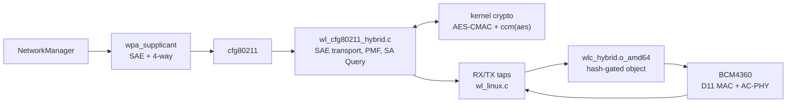

# WPA3-SAE and 802.11w for the Broadcom BCM4360

The BCM4360 (`14e4:43a0`) has no WPA3 in its closed `wl` driver. This project adds a host-side SAE
transport and software protected management frames (PMF) to the open cfg80211 glue that surrounds
the proprietary object.

It is a C compatibility layer, not a native driver. `wpa_supplicant` runs SAE and the 4-way
handshake; the kernel carries frames; host code verifies BIP and CCMP for management frames and
answers SA Query. The vendor object still owns the MAC, rate control and aggregation.

## Status

| Proven | Not claimed |
| --- | --- |
| Host tests for PMF, replay, framing and recovery stubs | A native Rust driver |
| One live session with SAE, `pmf=2` and BIP as the group cipher | On-air forgery or replay resistance measured independently |
| Explicit reconnect on the other band, radio off/on | Sustained throughput or a full stress matrix |
| DHCP over Wi-Fi after association | Other boards, other object builds, suspend certification |

Current evidence and the open hardware rows are in [TESTING.md](TESTING.md). Read that before
treating any capability as validated on your machine.

## Documentation

| Page | Contents |
| --- | --- |
| [Anatomy](Anatomy/README.md) | Implementable contracts for SAE, PMF, framing, the frozen ABI and a future native port |
| [TESTING.md](TESTING.md) | Gate status, local evidence and the hardware test protocol |
| [LOCAL.md](LOCAL.md) | Temporary trial and reversible current-kernel install |
| [FORK.md](FORK.md) | Every upstream file this fork changes |
| [docs/upstream-history.md](docs/upstream-history.md) | Original upstream engineering notes and test history, with provenance |
| [build.sh](build.sh) | Blob preparation, patch, relocate, link |

## Architecture



The blob is a non-stripped, relocatable ELF object, not a final firmware image. That is what makes
the bridge possible: the build links new C against it and redirects a small set of call sites.

## How the bridge works

1. `wpa_supplicant` performs SAE and the 4-way handshake.
2. The cfg80211 glue captures the SAE exchange through the RX tap and forwards every post-START
   authentication status to userspace.
3. The glue injects the supplicant's RSN and RSNX elements into the association request.
4. Host PMF verifies BIP for group robust management and CCMP for unicast management, keeps replay
   floors, sends SA Query and handles protected teardown.
5. Block Ack action frames are decrypted, re-injected, and the object's own ADDBA/DELBA frames are
   protected before transmission.

Three build steps prepare the object:

| Step | Effect |
| --- | --- |
| Byte patch | un-clamp the `auth` iovar so it accepts SAE (`alg=3`) |
| Symbol globalization | expose the object's internal call targets to the wrapper |
| Relocation rewrite | redirect `wlc_recv`, `wlc_sendauth`, `wlc_authresp_client` and `wlc_sendmgmt` calls to host wrappers |

## Capabilities

| Capability | State |
| --- | --- |
| WPA3-SAE transport through cfg80211 external auth | working in the tested session |
| Every post-START SAE status forwarded unchanged | working; covered by host tests |
| BIP-CMAC-128 group cipher negotiation | observed in the live session |
| BIP verification and replay | covered by host tests |
| CCMP for unicast management, replay floors and SA Query | covered by host tests |
| Protected Block Ack setup under PMF | implemented; not separately recorded in the live evidence |
| Stalled-link probe using retry ratio | implemented; probe-only by default |
| Bounded reconnect, rejoin quiet time, handshake watchdog | implemented |
| Reversible trial and installation with rollback | implemented; regression-tested with stubs |

The repository does not ship the proprietary object or a built module.

## Build

Requirements: matching kernel headers, `gcc`, `binutils`, `python3`, and the Linux AES-CMAC and
synchronous `ccm(aes)` crypto support.

The object is **not** in this repository. Obtain the pristine file from broadcom-sta
`6.30.223.271` and verify its hash:

```text
sha256 352a6e349f74c69b78e76f68c63752c99b8f6b22dc942af531b754211d7f4743
```

```sh
mkdir -p wl-src/lib
cp /path/to/wlc_hybrid.o_amd64 wl-src/lib/wlc_hybrid.o_amd64.orig
./build.sh        # -> wl-src/wl.ko
```

A built `wl.ko` is bound to the exact kernel it was built for (`vermagic`). Rebuild for any other
kernel before preparing a trial bundle. The current candidate targets `7.2.15-1-omarchy`.

## Trial and install

- Temporary, reversible trial: [LOCAL.md](LOCAL.md#temporary-trial-bundle)
- Persistent current-kernel install with saved-module rollback:
  [LOCAL.md](LOCAL.md#persistent-current-kernel-install)

Both paths keep the installed module, Wi-Fi profiles and router settings unchanged until the user
runs the elevated step. A reboot restores the stock module in both modes.

## Compatibility

The current C driver:

- works on 2.4 GHz and 5 GHz,
- inherits upstream suspend support,
- requires WPA3-SAE for PMF; a WPA2-PSK profile that requires PMF is refused rather than connected
  without protection,
- rejects a non-SAE join when MFP is required.

A future native port may lack 5 GHz or suspend initially. Those would be limitations of that port,
not of the current driver.

Public b43 work already covers parts of this chip. This project targets the closed `wl` path; it
does not claim to be the only Linux approach to BCM4360 hardware.

## Caveats

- `wlc_hybrid.o_amd64` is Broadcom proprietary. Never commit the object or a built module.
- Offsets are specific to broadcom-sta `6.30.223.271` and this exact hash.
- Management-frame protection is host software. It does not depend on device crypto.
- The live record is a single tested board and AP combination, not a hardware matrix.
- No on-air security measurement, sustained throughput result or long soak is claimed.
- Research code. The wrapper is GPL-2.0; the object keeps Broadcom's license.
